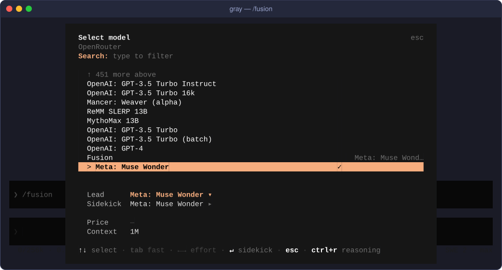
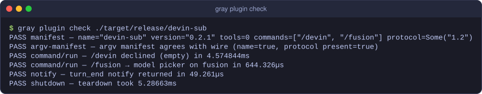

<p align="center">
  
</p>
<h1 align="center">gray-devin-sub</h1>
<p align="center">Run gray on a Devin subscription through the official <code>devin acp</code> CLI.</p>
<p align="center">
  <a href="LICENSE"></a>
  <a href="https://gray.alignment.id"></a>
  <a href="https://www.rust-lang.org"></a>
  <a href="https://github.com/vstaln/gray-devin-sub/releases"></a>
</p>

A protocol-1.2 provider sidecar that puts a **Devin subscription** behind
Gray's standard OpenAI-Responses transport: Gray keeps host-owned tools,
approvals, and compaction; Devin's CLI answers model requests.

## Screenshot

`/fusion` opens gray's model picker focused on the Fusion row — pick a lead
and a sidekick model for Fusion turns:



## Install

From the gray plugin hub:

```sh
gray plugin install devin
```

From source (needs a Rust toolchain):

```sh
cargo install --path .
gray plugin install ~/.cargo/bin/devin-sub
```

## Usage

Provider plugin: it declares no tools. Reference the provider as `devin-sub:devin-subscription` in your
Gray config (see `gray-antigravity-sub`'s README for the full
config shape — this sidecar is a drop-in sibling).

Slash commands (from the manifest):

- `/fusion` opens the model picker on the Fusion row; hosts without
  model-picker support print a text fallback instead.
- `/devin` is the operator surface. A bare `/devin` answers nothing, so the
  host falls back to its provider-login shortcut (the model picker on Devin's
  rows). `/devin tools …` runs the tool-policy command; any other argument
  prints usage plus the current policy.

## Configuration

Requires the Devin CLI on `PATH` and `devin auth login` already done.
Override the binary with `GRAY_DEVIN_SUB_COMMAND` if needed.

Set `DEVIN_SUB_DEBUG=1` to append one line per turn (reuse/fresh reason,
ACP session id, prompt chars, usage) to
`$TMPDIR/devin-sub-<pid>.log` — no prompt content.

## How it works

### Why this is ToS-safe

The sidecar talks to Devin exclusively through the **official
`devin acp` command** — Devin's documented Agent Client Protocol
integration, the same path editors like Zed and JetBrains use.
There is no token handling anywhere: authentication lives entirely inside
the Devin CLI (`devin auth login`); the sidecar never reads credentials
files, never captures tokens, and strips conflicting `DEVIN_*` variables (`DEVIN_MODEL`, `DEVIN_PERMISSION_MODE`, `DEVIN_SANDBOX`, `DEVIN_REFUSAL_FALLBACK`) from the child process, so the sidecar's own model and permission flags always win.

### How a turn works

1. `provider/chat` opens a per-turn loopback relay and hands the host a
   one-shot bearer URL. The relay admits exactly one POST — the
   "one upstream request per chat turn" budget is enforced by a
   consumed-token admission guard, not by trust.
2. The admitted OpenAI Responses body is answered by a **pooled**
   `devin acp` session (`initialize → session/new`, then one
   `session/prompt` per turn). Children run in a shared scratch cwd whose
   `.devin/config.json` denies every native tool, under a generated user
   config with subagents/MCP/auto-update off. Devin's prompt cache is
   per-session: when the request's history strictly continues what a
   pooled session last answered — same model, same prepared system text,
   same prefix, and the host's replay of the last answer byte-identical —
   that session gets prompted with only the delta (`[Tool result]` /
   `[User]` blocks) and ~the whole transcript is already upstream.
   Anything else spawns a fresh `devin acp`. Sessions idle 60 min (or
   dead) are reaped; the pool caps at 4 children.
3. Gray's tools ride in as a text funnel contract (`​```gray_calls`
   fenced block); models that ignore it and reach for a native `exec` /
   `read` are caught by `tool_call` notifications and redirected onto the
   host's `bash` tool, then the prompt is cancelled.
4. The reply (text, thought summary, calls, usage) is folded back into
   the Responses SSE stream the host already understands. Turns that run
   past 20s answer as a close-delimited stream with `: keepalive`
   comments every 15s — the host's HTTP client times out idle reads — and
   a client disconnect sends `session/cancel` upstream instead of letting
   an abandoned turn bill.

`session/request_permission` is always answered `cancelled` — a harness
turn never waits on an interactive prompt.

<details>
<summary>Conformance</summary>

`gray plugin check` output for this build:



</details>

## License

MIT. See [LICENSE](LICENSE).

## Links

- Gray: <https://gray.alignment.id>
- Gray source: <https://github.com/vstaln/gray>
- Plugin hub: <https://gray.alignment.id/plugins/devin/>

Part of the [gray](https://github.com/vstaln/gray) plugin ecosystem — the open-source AI agent harness.
